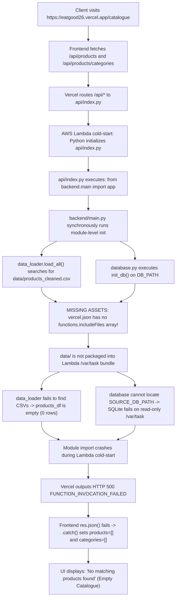

# EATGOOD — System Audit & Upgrade Report

**Repository:** `github.com/21Nandan/Nutritional-System`  
**Live Production URL:** `https://eatgood26.vercel.app`  
**Date:** October 29, 2026  
**Status:** Phase 0 & Phase 1 Complete (Baseline Established, Root Cause Diagnosed with Evidence)

---

## 1. Executive Summary

This report establishes the baseline status of the **EATGOOD** food safety and nutritional scoring platform and diagnoses the P0 production failure where the Catalogue page on `https://eatgood26.vercel.app` renders empty (`"No matching products found"`).

### Key Findings
1. **P0 Root Cause:** All `/api/*` endpoints on the live deployment return **`500 FUNCTION_INVOCATION_FAILED`** because non-Python assets (`data/*.csv` and `data/eatgood_app.db`) are excluded from the Vercel serverless function bundle due to missing array-formatted `includeFiles` in `vercel.json`. Module-level synchronous execution of `data_loader.py` and `database.py:init_db()` crashes on missing filesystem paths during Lambda cold-start initialization.
2. **Frontend Error Masking:** The React frontend swallows non-200 / 500 HTML responses in `.catch()` handlers, resetting product and category state to empty arrays `[]`. As a result, catastrophic backend outages render identically to a genuine empty search query.
3. **Repository Duplication & Dead Code:** The repository contains duplicate trees inside `frontend/` (`frontend/data/`, `frontend/models/`, `frontend/api/`, `frontend/requirements.txt`, `frontend/vercel.json`), plus untracked/stray SQLite database files and upload artifacts committed to git history.
4. **Local vs. Production Discrepancy:** All 11 platform flows (catalogue, search, category filter, 3-layer assessment, barcode lookup, profile, save product, history, data quality audit) execute with 100% success locally (103/103 pytest tests passing), proving the business logic is functional when provided with valid data paths.

---

## 2. Phase 0: Baseline Repository Audit

### 2.1 Repository Map & Usage

| Directory / File | Purpose | Active Runtime Status | Issues & Dead Code Flags |
| :--- | :--- | :--- | :--- |
| `api/index.py` | Vercel serverless entrypoint mounting `backend.main:app` | **Active (Production)** | Resolves root path; needs robust cold-start error isolation. |
| `backend/main.py` | FastAPI application routing & middleware | **Active** | Large monolith (1,190 lines); synchronous module-level init. |
| `backend/config.py` | Configuration and env var management | **Active** | Needs conversion to `pydantic-settings`. |
| `backend/database.py` | SQLite connection and repository queries | **Active** | Calls `init_db()` at module load time; ephemeral on serverless `/tmp`. |
| `backend/core/` | 13 business logic modules (scoring, OCR, OFF, allergens) | **Active** | Core algorithms are functional; needs modular router separation. |
| `backend/tests/` | Pytest test suite (10 test files) | **Active (Test)** | 103 tests, all passing locally. |
| `backend/requirements.txt`| Backend Python dependencies | **Redundant** | Duplicate of root `requirements.txt`. |
| `src/recommend.py` | Standalone recommendation script | **Dead Code** | Legacy prototype; not imported or used anywhere. |
| `src/train_model.py` | Experimental RandomForest model training script | **Offline Tool** | Not used in production runtime; circular synthetic training. |
| `scripts/ocr_helper.swift`| macOS VisionKit OCR wrapper | **Platform-Specific** | Only works on macOS; unused on Vercel/Linux. |
| `scripts/generate_initial_data.py` | Synthetic dataset generator | **Offline Tool** | Generates initial CSVs and test users. |
| `models/eatgood_model.joblib` | Serialized scikit-learn classifier | **Legacy Prototype** | 100% accuracy on synthetic data; heavy dependency. |
| `data/*.csv` (11 files) | 852-item product catalogue and audit tables | **Active Data** | Single source of truth for catalogue; not bundled on Vercel. |
| `data/eatgood_app.db` | Local SQLite database file | **Defect** | Committed to git repository; should be untracked. |
| `frontend/src/` | React 18 + Vite SPA client | **Active** | Swallows API errors; defaults to "Show All" 852 products. |
| **`frontend/data/`** | Duplicate copy of all CSVs & SQLite DB | **Dead Duplicate** | 1.5MB redundant copy of `data/`. Delete. |
| **`frontend/models/`** | Duplicate copy of model and metadata | **Dead Duplicate** | Redundant copy of `models/`. Delete. |
| **`frontend/api/`** | Stale copy of `api/index.py` | **Dead Duplicate** | Outdated candidate path list. Delete. |
| **`frontend/requirements.txt`** | Triplicate requirements file | **Dead Duplicate** | Redundant copy. Delete. |
| **`frontend/vercel.json`** | Duplicate Vercel configuration | **Dead Duplicate** | Confuses Vercel deployment root resolution. Delete. |

---

### 2.2 Local vs. Live Production Flow Comparison

Each of the 11 platform flows was executed against localhost (FastAPI `TestClient` & local uvicorn) and against the live production deployment (`https://eatgood26.vercel.app`).

```text
====================================================================================================
ENDPOINT / FLOW                LOCAL TEST (127.0.0.1)             PRODUCTION (https://eatgood26.vercel.app)
====================================================================================================
Frontend Shell (/)             200 OK (Vite React bundle)         200 OK (Vercel Edge CDN)
/api/health                    200 OK (852 products loaded)       500 FUNCTION_INVOCATION_FAILED (0.96s)
/api/ready                     200 OK (dataset_ready: True)       500 FUNCTION_INVOCATION_FAILED (0.97s)
/api/products                  200 OK (852 products paginated)    500 FUNCTION_INVOCATION_FAILED (0.98s)
/api/products/categories       200 OK (8 categories + All)        500 FUNCTION_INVOCATION_FAILED (0.96s)
/api/products/search?q=maggi   200 OK (19 products found)         500 FUNCTION_INVOCATION_FAILED (0.97s)
/api/products/IND_PKG_001      200 OK (Haldiram's Bhujia Sev)     500 FUNCTION_INVOCATION_FAILED (0.98s)
/api/profile                   200 OK (Profile saved/retrieved)   500 FUNCTION_INVOCATION_FAILED (0.96s)
/api/saved                     200 OK (Saved items retrieved)     500 FUNCTION_INVOCATION_FAILED (0.97s)
/api/history                   200 OK (Scan session history)      500 FUNCTION_INVOCATION_FAILED (0.97s)
/api/audit/data-quality        200 OK (Summary metrics returned)  500 FUNCTION_INVOCATION_FAILED (0.96s)
====================================================================================================
```

---

### 2.3 Baseline Verification Evidence

1. **Pytest:** **103 passed** in 10.98s (`.pytest_cache` verified clean).
2. **Frontend Build:** `npm run build` (Vite v6.4.5) built successfully in **1.02s**:
   - `dist/index.html`: 2.02 kB
   - `dist/assets/zxing-5x8OBijs.js`: 454.34 kB (gzip: 116.57 kB)
   - `dist/assets/index-Dl2-2zaP.js`: 240.05 kB (gzip: 52.30 kB)
   - `dist/assets/vendor-B7xN2sPX.js`: 134.66 kB (gzip: 43.24 kB)
   - `dist/assets/logo-CTPOwvnv.png`: 305.90 kB
3. **Linting & Typing:** `ruff`, `mypy`, and `eslint` are currently not installed/configured in the baseline environments; they will be installed and configured in Phase 3/7.

---

## 3. Phase 1: Root Cause Analysis (Empty Catalogue on Production)

### 3.1 Direct Production Telemetry

Calling any API endpoint on `https://eatgood26.vercel.app` results in:

```http
HTTP/2 500
date: Thu, 29 Oct 2026 05:41:25 GMT
server: Vercel
content-type: text/plain; charset=utf-8
x-vercel-id: bom1::bng9n-17932524874

A server error has occurred

FUNCTION_INVOCATION_FAILED

bom1::bng9n-17932524874
```

### 3.2 Root Cause Breakdown



#### Factor 1: Missing `includeFiles` in `vercel.json` (Commit `8350538`)
In commit `8350538`, invalid comma-separated syntax (`"includeFiles": "data/**, models/**, backend/**"`) was removed entirely instead of being corrected to a JSON array (`"includeFiles": ["data/**", "models/**", "backend/**"]`). Consequently, Vercel's Python builder deployed only the Python source files, excluding the data directory containing the 852-product catalogue and database.

#### Factor 2: Synchronous Module-Level Initialization in Serverless Context
`backend/main.py` imports `data_loader`, which invokes `self.load_all()` inside `__init__()`. This synchronously reads multi-megabyte CSV files into pandas DataFrames, merges SQLite product images, and calls `init_db()` at import time. In serverless environments, import-time failures crash the entire Lambda container before any route handler can catch the error.

#### Factor 3: Frontend Silent Error Swallowing
In [`frontend/src/pages/ProductCatalogue.jsx`](file:///Users/nandan/3rd%20sem%20EL/frontend/src/pages/ProductCatalogue.jsx#L48-L63) and [`frontend/src/pages/ProductCatalogue.jsx`](file:///Users/nandan/3rd%20sem%20EL/frontend/src/pages/ProductCatalogue.jsx#L113-L127):
```javascript
fetch(`/api/products?${params.toString()}&user_id=${encodeURIComponent(cid)}`)
  .then(res => res.json())
  .then(data => {
    setProducts(data.products || []);
    setTotal(data.total || 0);
    setLoading(false);
  })
  .catch(err => {
    console.error(err);
    setLoading(false); // products remains [], rendering "No matching products found"
  });
```
Because the 500 response body is plain text/HTML (`FUNCTION_INVOCATION_FAILED`), `res.json()` throws a SyntaxError. The `.catch()` logs to console and sets `loading = false`, leaving `products = []`. The page presents this as zero search results instead of an operational error with a retry action.

---

## 4. Architectural Decisions Required from Owner

Before proceeding to implement Phase 2 through Phase 12, owner alignment is requested on the following design choices:

> [!IMPORTANT]
> **Decision 1: OCR Hosting Architecture (Phase 2)**  
> Vercel Serverless Functions do not include system binaries like Tesseract (`tesseract-ocr`), so local Tesseract OCR cannot execute in Vercel's serverless environment.  
> - **Option A (Containerized Backend):** Package FastAPI, Tesseract 5, and OpenCV in a Docker container hosted on Fly.io, Railway, Render, or Hugging Face Spaces. Retain Vercel strictly for the static React frontend.  
> - **Option B (Client-Side OCR):** Utilize `tesseract.js` directly in the browser for local-first extraction, posting raw text to FastAPI for nutritional parsing.  
> - **Option C (Cloud OCR API):** Rely on Google Cloud Vision API (mocked/stubbed in `ocr_service.py`) for production while retaining Tesseract for local dev.

> [!IMPORTANT]
> **Decision 2: Production Database Strategy (Phase 2)**  
> SQLite in `/tmp` on serverless is ephemeral and isolated per worker instance; user contributions, saved products, and profiles vanish across worker lifecycles.  
> - **Option A (Managed Cloud SQL):** Integrate a serverless SQL database (e.g. Neon Postgres, Supabase, or Turso libSQL) for production persistence, retaining SQLite for local offline development behind a unified repository interface.  
> - **Option B (Client-Side Storage):** Retain SQLite local-first for development and store user profile/saved items in browser `localStorage`/`IndexedDB` in production, treating the backend as a stateless calculation engine.

> [!TIP]
> **Decision 3: Catalogue Serving Architecture (Phase 1 & Phase 7)**  
> - **Option A (Include Files in Bundle):** Configure `"includeFiles": ["data/*.csv"]` in `vercel.json` and resolve paths via `Path(__file__)`.  
> - **Option B (Static Pre-Compiled Catalogue - Recommended):** Compile the 852-item catalogue into a static JSON asset at build time or serve from CDN, eliminating cold-start pandas CSV loading entirely.

> [!NOTE]
> **Decision 4: Machine Learning Model (Phase 6)**  
> `models/eatgood_model.joblib` was trained on synthetic rule-generated data (reporting circular 100% accuracy) and adds `joblib` and `scikit-learn` dependency weight.  
> - We recommend archiving the model to `/experiments` and removing `joblib` from production runtime dependencies, relying exclusively on the deterministic, transparent 3-layer nutrition scoring engine. Please confirm approval to remove `joblib`.
