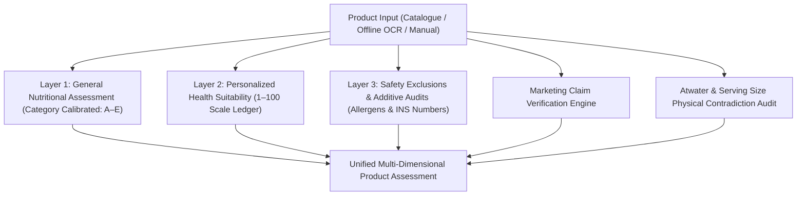
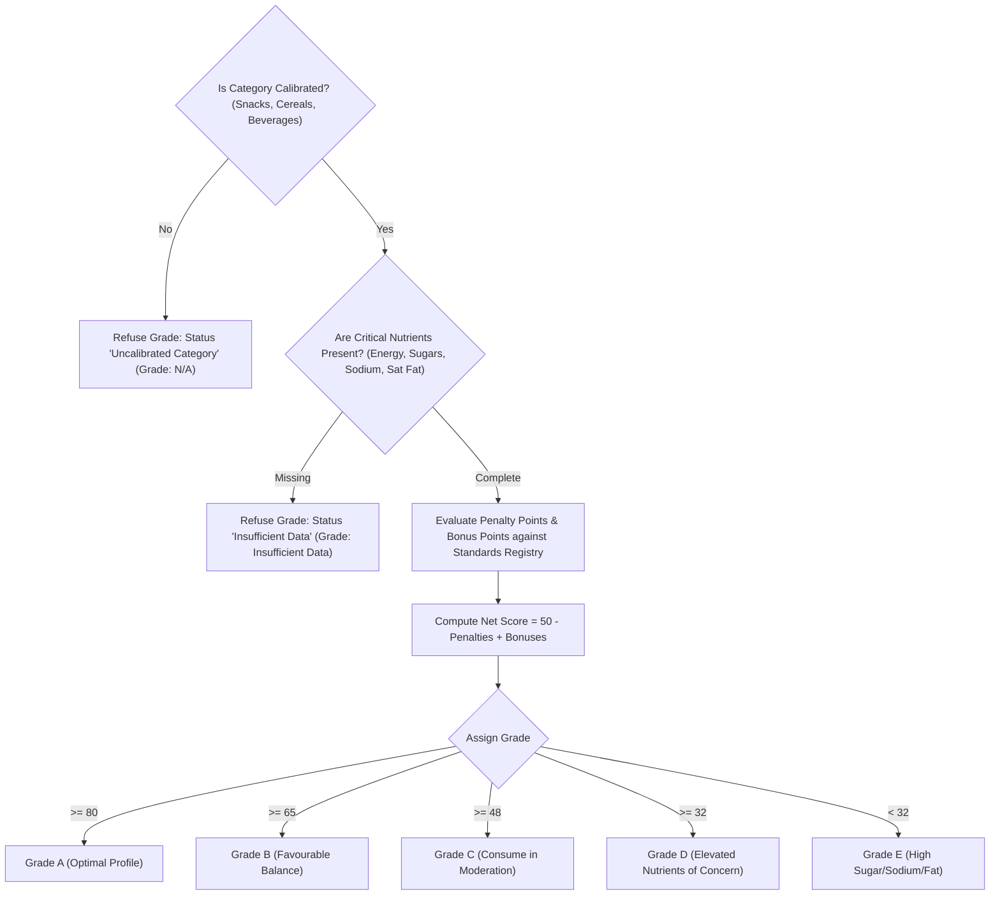
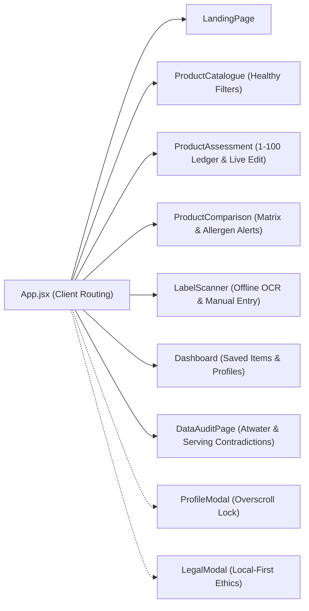

# EATGOOD — Complete System Architecture & Technical Specification

> **Platform Version:** 2.0 (Local-First Clinical & Regulatory Auditing Prototype)  
> **Target Jurisdiction:** Indian Packaged Food Ecosystem (FSSAI, WHO SEARO, Codex Alimentarius)  
> **Execution Environment:** 100% Offline Local Inference & Storage (`localhost:8000`)

---

## 1. Executive Summary & Problem Statement

### 1.1 The Challenge: Deceptive Labelling in Packaged Foods
In contemporary retail food environments—particularly within the Indian packaged food sector—consumers are inundated with front-of-pack claims (*"No Added Sugar"*, *"High Protein"*, *"Zero Cholesterol"*, *"100% Natural"*). However:
1. **Misleading Marketing Claims**: Products declaring *"No Added Sugar"* frequently contain concentrated hidden sugars (liquid glucose, maltodextrin, inverted sugar syrup, concentrated apple juice). Products claiming *"High Protein"* often supply less than 4g per 100g, failing the statutory Codex threshold of $\ge 10\text{g}/100\text{g}$ or $20\%$ of energy.
2. **Nutritional Physical Contradictions**: Manufacturers occasionally declare per-100g nutrition while asserting a 15g–25g package serving, causing physical contradictions where:
   $$\text{Carbohydrates} + \text{Protein} + \text{Fat} > \text{Stated Serving Size}$$
3. **Atwater Caloric Anomalies**: Stated caloric values often deviate wildly from standard thermodynamic Atwater factors ($4 \times \text{Protein} + 4 \times \text{Carbs} + 9 \times \text{Fat}$), exposing discrepancies exceeding $\pm 20\%$ to $\pm 50\%$.
4. **Uncalibrated Global Scoring Algorithms**: Systems like Nutri-Score or Health Star Rating developed in Europe or Australasia cannot be naively applied to Indian diets without category-specific benchmark calibration (e.g. distinguishing traditional pulses from fried palm-oil savouries).
5. **Privacy Risks in Health Tech**: Most consumer nutrition applications upload personal biometric profiles, medical goals, and dietary habits to remote cloud servers for targeted advertising.

### 1.2 The Solution: EATGOOD
**EATGOOD** is a local-first, evidence-based, 3-layer food intelligence and auditing system designed to provide transparent, multi-dimensional assessments of packaged foods. It refuses to make up data, refuses uncalibrated category pseudo-grades, explicitly audits packaging contradictions, and calibrates personalized suitability on an auditable **1 to 100 scale**.



---

## 2. Complete Technology Stack

| Layer | Technology | Version | Purpose & Implementation Details |
| :--- | :--- | :--- | :--- |
| **Backend Runtime** | **Python** | `3.9.6+` | Core numerical computation, pandas DataFrame processing, regex pattern parsing, and scoring engine. |
| **Backend Framework**| **FastAPI** | `0.115+` | High-performance asynchronous REST API framework providing automated OpenAPI documentation, typed Pydantic models, and CORS middleware. |
| **ASGI Web Server** | **Uvicorn** | `0.30+` | ASGI web server running local reload daemon on `127.0.0.1:8000`. |
| **Data Processing** | **Pandas & NumPy** | `2.2+` | In-memory indexing of 852 audited retail products, vector querying, Atwater caloric variance calculation, and category aggregations. |
| **Database Engine** | **SQLite3** | `3.x` | Embedded zero-configuration local database (`data/eatgood_app.db`). Stores user profiles, saved favorites, and local audit histories without cloud egress. |
| **OCR Vision Engine**| **macOS Native Vision / Pytesseract** | `Native CLI / 0.3.10` | Offline, on-device optical character recognition for extracting nutritional fact panels and ingredient lists from packaging images. |
| **Frontend Framework**| **React** | `18.3+` | Component-based interactive UI with stateful client-side rendering and local state persistence. |
| **Frontend Build Tool**| **Vite** | `6.4+` | Fast ES-module development and production bundler compiling to static distribution bundles (`frontend/dist/`). |
| **Iconography** | **Lucide React** | `0.454+` | Clean, accessible SVG vector icon system for food grades, alerts, macro indicators, and navigational elements. |
| **Styling & Theme** | **Custom CSS3** | `Vanilla CSS` | Tailored design system with semantic CSS variables (`--color-primary`, `--color-accent`, etc.), responsive flex/grid layouts, card elevations, and overscroll containment. |
| **Testing Suite** | **Pytest** | `8.4+` | Automated regression test harness executing 9 comprehensive unit tests verifying data integrity, scoring bounds, allergen exclusions, and catalogue filters. |

---

## 3. High-Level Architectural Directory Structure

```
3rd sem EL/
├── backend/
│   ├── core/
│   │   ├── standards_registry.py    # Authoritative WHO, FSSAI & Codex nutritional thresholds
│   │   ├── data_loader.py           # 852-product dataset loader, search & multi-parameter filter engine
│   │   ├── nutrition_scoring.py     # Layer 1 (General Grade) & Layer 2 (Personalized 1-100 Score)
│   │   ├── allergen_engine.py       # Layer 3 allergen keyword & INS additive toxicological review
│   │   ├── claims_detector.py       # Front-of-pack claim verification against declared lab data
│   │   ├── recommender.py           # In-category healthier alternative ranking engine
│   │   ├── ocr_service.py           # Vision OCR preprocessing & regex label parsing
│   │   └── ml_model.py              # Secondary ML validation service with transparency notes
│   ├── database.py                  # SQLite3 schema management, profile sync & analysis history
│   ├── main.py                      # FastAPI application routes, static file serving & CORS
│   └── tests/
│       └── test_eatgood_core.py     # 9 automated unit tests verifying core algorithms
├── data/
│   ├── eatgood_app.db               # SQLite local database (profiles, history, favorites)
│   ├── products_standardized.csv    # 852 curated retail products with Atwater & macro metrics
│   ├── data_quality_report.csv      # Macro serving & calorie discrepancy audit summary
│   ├── flagged_products_inspection.csv # Specific products with declared anomalies
│   └── users.csv                    # Simulated user profile archetypes
└── frontend/
    ├── public/                      # Static assets, SVG favicons, apple touch icons, logo
    ├── src/
    │   ├── App.jsx                  # Root layout, persistent scanner state, page routing
    │   ├── index.css                # Global design system & modal overscroll containment
    │   ├── main.jsx                 # React DOM mount point
    │   ├── components/
    │   │   ├── Navbar.jsx           # Top navigation bar with active profile pill
    │   │   ├── Footer.jsx           # Governance footer with Legal & Privacy triggers
    │   │   ├── ProfileModal.jsx     # Interactive multi-goal, allergen, and activity modal
    │   │   ├── LegalModal.jsx       # Offline privacy ethics and terms modal
    │   │   └── useLockBodyScroll.js # Custom hook preventing background scroll chaining
    │   └── pages/
    │       ├── LandingPage.jsx      # Portal homepage with feature cards & search entry
    │       ├── ProductCatalogue.jsx # 852-product explorer with healthy default filters
    │       ├── ProductAssessment.jsx# 3-Layer report with 1-100 score ledger & live editor
    │       ├── ProductComparison.jsx# Multi-product side-by-side matrix (2-4 products)
    │       ├── LabelScanner.jsx     # Offline OCR upload & manual entry studio
    │       ├── Dashboard.jsx        # User profile summary, history logs, and saved items
    │       └── DataAuditPage.jsx    # Transparency audit on Atwater & macro serving anomalies
```

---

## 4. Deep-Dive: Core Subsystems & Engines

### 4.1 Layer 1: Category-Calibrated General Nutritional Assessment
*Source code:* [`backend/core/nutrition_scoring.py`](file:///Users/nandan/3rd%20sem%20EL/backend/core/nutrition_scoring.py#L15)

Layer 1 evaluates baseline nutritional balance based on public health standards rather than arbitrary point systems.



#### Calibration Boundaries:
1. **Calibrated Scope**: Currently covers **Snacks**, **Breakfast Cereals**, and **Packaged Beverages**.
2. **Transparent Refusal**: Uncalibrated categories (e.g. *Chocolates & Sweets*, *Condiments & Spreads*, *Instant Foods*, *Dairy*) return:
   ```json
   {
     "status": "Uncalibrated Category",
     "grade": "N/A",
     "grade_label": "Category Not Yet Calibrated",
     "explanation": "Products in this category are not currently calibrated under the active WHO/FSSAI prototype benchmarks..."
   }
   ```
3. **Data Completeness Enforcement**: If any of the 4 critical baseline nutrients ($\text{Energy}$, $\text{Total Sugars}$, $\text{Sodium}$, $\text{Saturated Fat}$) are omitted, Layer 1 refuses to invent values and assigns **"Insufficient Data"**.

---

### 4.2 Layer 2: Personalized Health Suitability (1 to 100 Scale)
*Source code:* [`backend/core/nutrition_scoring.py`](file:///Users/nandan/3rd%20sem%20EL/backend/core/nutrition_scoring.py#L185)

Layer 2 tailors evaluation to the consumer's active health targets, dietary preferences, and safety restrictions.

#### 1 to 100 Calibration Scale:
* **`1`**: Most unhealthy / severe conflict with user's goals.
* **`50`**: Moderate nutritional balance.
* **`100`**: Healthiest / ideal alignment with active profile.
*(Note: A critical allergen violation overrides score to `0` for immediate safety warning).*

#### Incomplete Data Refusal:
If a user submits incomplete packaging data (e.g. leaving sugars and sodium blank), Layer 2 refuses to guess and outputs:
```python
{
    "personalized_score": None,
    "has_insufficient_data": True,
    "score_display": "N/A",
    "suitability_status": "Insufficient Data to Calculate Personalized Score",
    "suitability_badge": "Incomplete Data",
    "color": "gray",
    "calculation_breakdown": None
}
```

#### Step-by-Step Transparent Calculation Ledger:
When valid declarations are entered, the engine starts from a neutral baseline of **70 points** and records every modification:

| Step | Factor | Condition / Benchmark | Signed Points | Running Total |
| :---: | :--- | :--- | :---: | :---: |
| **#1** | **Baseline Profile Neutral Score** | Standard 1–100 calibration baseline | `70` | **70** |
| **#2** | **Goal: Reduce Sugar** | Total sugars $\le 3\text{g}/100\text{g}$ | `+20` | **90** |
| **#3** | **Goal: Reduce Sugar** | Total sugars $> 20\text{g}/100\text{g}$ | `-30` | **60** |
| **#4** | **Goal: Reduce Sodium** | Sodium $\le 140\text{mg}/100\text{g}$ | `+20` | **80** |
| **#5** | **Goal: Reduce Sodium** | Sodium $> 900\text{mg}/100\text{g}$ | `-30` | **50** |
| **#6** | **Goal: Increase Fibre** | Codex high-fibre standard ($\ge 6\text{g}$) | `+25` | **75** |
| **#7** | **Goal: Increase Protein** | High protein standard ($\ge 12\text{g}$) | `+25` | **100** |
| **#8** | **Heart Health Factor** | Saturated fat $> 8\text{g}/100\text{g}$ | `-15` | **85** |
| **#9** | **Heart Health Factor** | Low saturated fat $\le 1.5\text{g}/100\text{g}$ | `+5` | **90** |
| **#10**| **WHO REPLACE Standard** | Industrial trans fat declared ($> 0.1\text{g}$) | `-20` | **70** |
| **#11**| **Dietary Preference Conflict** | Contains ingredients violating Vegan/Vegetarian choice | `Cap @ 15` | **15** |
| **#12**| **Final Calibration** | Clamped strictly to $[1, 100]$ interval | `=` | **Final Score** |

---

### 4.3 Layer 3: Hard Safety Exclusions & Additives Analysis
*Source code:* [`backend/core/allergen_engine.py`](file:///Users/nandan/3rd%20sem%20EL/backend/core/allergen_engine.py)

#### 1. Allergen Avoidance Engine:
Tracks 10 major FSSAI-mandated allergen categories:
* **Milk** (*casein, whey, lactose, curd, paneer, milk solids*)
* **Soy** (*soya, edamame, soy lecithin, hydrolysed soy protein*)
* **Gluten** (*wheat, maida, atta, barley, malt, rye, semolina*)
* **Peanuts** (*groundnut, arachis*)
* **Tree Nuts** (*almond, cashew, walnut, pistachio, hazelnut*)
* **Eggs** (*albumin, egg powder, lysozyme*)
* **Fish** (*anchovy, cod, fish gelatin*)
* **Crustaceans** (*prawn, shrimp, crab*)
* **Sesame** (*til, gingelly*)
* **Sulphites** (*E220-E228, sodium metabisulphite*)
* **Custom User-Added Allergens**: Dynamic keyword matching for user-specified ingredients (e.g. Mustard, Pine nuts).

When a conflict is detected with the active user profile:
1. `personalized_score` is strictly set to `0`.
2. A critical red alert banner is displayed.
3. The product is automatically excluded from recommendations.

#### 2. Food Additives & INS Number Scanner:
Scans the ingredient list for International Numbering System (INS / European E-number) codes:
* Detects functional categories: **Preservatives**, **Emulsifiers**, **Stabilizers**, **Artificial Sweeteners** (Aspartame INS 951, Sucralose INS 955, Acesulfame K INS 950), and **Colouring Agents** (Tartrazine INS 102, Sunset Yellow INS 110).
* Provides educational notes explaining the technological purpose of each additive without non-scientific alarmism.

---

### 4.4 Misleading Marketing Claim Verification
*Source code:* [`backend/core/claims_detector.py`](file:///Users/nandan/3rd%20sem%20EL/backend/core/claims_detector.py)

Audits front-of-pack claims against verified lab facts using Codex and FSSAI rules:
* **"Zero Sugar" / "Sugar Free"**: Requires total sugars $\le 0.5\text{g}/100\text{g}$. Flags inconsistencies if higher.
* **"No Added Sugar"**: Verifies that `added_sugars_g == 0` and inspects ingredient lists for disguised sugars (*liquid glucose, maltodextrin, inverted sugar, corn syrup, fruit juice concentrate*).
* **"High Protein"**: Requires $\ge 10\text{g}$ protein per $100\text{g}$ (Codex CAC/GL 23-1997). If declared protein is only $3\text{g}$–$5\text{g}$, the claim is flagged as **"Potential Inconsistency"**.
* **"Low Fat"**: Requires total fat $\le 3.0\text{g}/100\text{g}$.
* **"Zero Trans Fat"**: Confirms trans fats $< 0.1\text{g}$.

---

### 4.5 Data Quality & Physical Anomaly Auditing
*Source code:* [`backend/core/data_loader.py`](file:///Users/nandan/3rd%20sem%20EL/backend/core/data_loader.py#L132), [`frontend/src/pages/DataAuditPage.jsx`](file:///Users/nandan/3rd%20sem%20EL/frontend/src/pages/DataAuditPage.jsx)

EATGOOD performs mathematical checks directly on the retail packaging dataset ($852\text{ products}$):

#### 1. Atwater Thermodynamic Discrepancy Detector:
Computes the expected caloric density:
$$\text{Expected Energy (kcal)} = (4 \times \text{Carbohydrates}) + (4 \times \text{Protein}) + (9 \times \text{Total Fat})$$
Products with declared energy deviating from expected energy by $> 50\text{ kcal}$ or $> 25\%$ are flagged. **78 products** in the audit dataset exhibit Atwater inconsistencies.

#### 2. Macronutrient Serving Size Physical Contradiction:
Checks for physical impossibility:
$$(\text{Carbohydrates} + \text{Protein} + \text{Total Fat}) > \text{Stated Serving Size}$$
Commonly occurs when a manufacturer declares per-100g values in the nutrition table but prints a 15g–25g single-serve packet size. **13 products** in the audit dataset exhibit this physical contradiction.

---

### 4.6 Offline Label Scanner (Vision OCR & Regex Parser)
*Source code:* [`backend/core/ocr_service.py`](file:///Users/nandan/3rd%20sem%20EL/backend/core/ocr_service.py), [`frontend/src/pages/LabelScanner.jsx`](file:///Users/nandan/3rd%20sem%20EL/frontend/src/pages/LabelScanner.jsx)

* **100% Offline Local Inference**: Processes packaging photos on the local device without sending images to third-party cloud vision APIs.
* **Dual-Mode Input**:
  1. **OCR Label Scan**: Local text extraction $\to$ regex extraction of key nutrients $\to$ editable confirmation modal.
  2. **Manual Nutrition Fact Entry**: Direct entry form for consumers with custom home-cooked items or un-scannable wrinkled wrappers.
* **In-Page Recalculation**: The assessment screen features a live `✏️ Edit Entered Data` modal, allowing consumers to adjust declarations and immediately recalculate scores without losing state.

---

### 4.7 Healthier Alternative Recommender
*Source code:* [`backend/core/recommender.py`](file:///Users/nandan/3rd%20sem%20EL/backend/core/recommender.py)

When assessing a product with high sugar, high sodium, or low personalized suitability:
1. Searches candidates strictly within the **same food category**.
2. Applies **hard exclusions**: excludes any candidate with allergen conflicts or dietary preference violations.
3. Computes relative nutrient advantages:
   $$\text{Sugar Delta} = \text{Current Sugar} - \text{Alternative Sugar}$$
   $$\text{Reduction \%} = \frac{\text{Sugar Delta}}{\text{Current Sugar}} \times 100$$
4. Sorts candidates by personalized suitability score descending.

---

## 5. Frontend UI/UX Architecture & Components



### 5.1 Interactive Catalogue with Healthy-Level Defaults
* Located in [`frontend/src/pages/ProductCatalogue.jsx`](file:///Users/nandan/3rd%20sem%20EL/frontend/src/pages/ProductCatalogue.jsx).
* **Pre-Selected Healthy Filters**: By default, the catalogue initializes to WHO healthy benchmarks:
  * **Sugars**: $\le 10\text{g}/100\text{g}$
  * **Sodium**: $\le 400\text{mg}/100\text{g}$
  * **Saturated Fat**: $\le 4\text{g}/100\text{g}$
* **One-Click Controls**: Features `🌿 Reset to Healthy Level` and `Show All Products (Clear Filters)`.
* **Search & Variant Deduplication**: Deduplicates synthetic packaging variations (*e.g.* `Coca-Cola (Variant 1)`, `(Variant 2)`) to present clean results (*Original Classic*, *Diet Coke*, *Zero Sugar*).

### 5.2 Modal Overscroll Containment & Scroll Lock
* Source: [`frontend/src/components/useLockBodyScroll.js`](file:///Users/nandan/3rd%20sem%20EL/frontend/src/components/useLockBodyScroll.js) and [`frontend/src/index.css`](file:///Users/nandan/3rd%20sem%20EL/frontend/src/index.css#L288).
* Solves the background scrolling issue when scrolling inside modals:
  * Applies `overscroll-behavior: contain;` and `-webkit-overflow-scrolling: touch;` on `.modal-overlay` and `.modal-card`.
  * Dynamically locks `document.body.style.overflow = 'hidden'` while any modal is active, restoring original styles upon closing.

---

## 6. Complete REST API Specification

| HTTP Method | Route | Description & Parameters |
| :--- | :--- | :--- |
| `GET` | `/api/health` | System health check, product counts, and active engines. |
| `GET` | `/api/products` | Paginated product search. Query params: `query`, `category`, `brand`, `max_sugars`, `max_sodium`, `max_sat_fat`, `min_fibre`, `min_protein`, `limit`, `offset`. |
| `GET` | `/api/products/categories` | Returns all available categories and marks calibrated categories. |
| `GET` | `/api/products/{product_id}` | Full 3-layer assessment tailored to active user profile. |
| `POST` | `/api/products/assess` | Assesses custom or user-edited nutrition declarations. |
| `POST` | `/api/analyze/ocr` | Accepts uploaded label image, runs local OCR, and returns parsed fields. |
| `GET` | `/api/compare` | Compares 2 to 4 products by IDs (`ids=ID1,ID2`). |
| `GET` | `/api/alternatives/{product_id}` | Returns top healthier alternatives in the same category. |
| `GET` | `/api/profile` | Returns active user profile from local SQLite database. |
| `POST` | `/api/profile` | Updates active health targets, dietary preferences, and allergens. |
| `GET` | `/api/standards` | Returns authoritative standards registry (WHO, FSSAI, Codex). |
| `GET` | `/api/audit` | Returns dataset audit metrics (Atwater anomalies, macro contradictions). |
| `GET` | `/api/history` | Returns recent assessment history log. |
| `POST` | `/api/saved/{product_id}` | Toggles product save status in local favorites. |
| `GET` | `/api/saved/check/{product_id}` | Checks if product is saved. |
| `GET` | `/api/saved` | Returns all saved favorites. |
| `GET` | `/favicon.svg`, `/favicon.ico`, `/apple-touch-icon.png` | Serves vector brand icons and cache-busting headers. |

---

## 7. Automated Test Suite Verification

The system includes a dedicated unit test suite in [`backend/tests/test_eatgood_core.py`](file:///Users/nandan/3rd%20sem%20EL/backend/tests/test_eatgood_core.py), executable via `pytest`:

```bash
PYTHONPATH=. backend/venv/bin/pytest backend/tests/test_eatgood_core.py -v
```

### Verified Test Cases:
1. `test_data_loader_integrity`: Asserts 852 products loaded, 78 Atwater anomalies, and 13 macro serving contradictions.
2. `test_layer1_calibrated_vs_uncalibrated`: Verifies calibrated grading for Snacks vs transparent refusal for Chocolates.
3. `test_missing_data_refusal`: Verifies Layer 1 refusal when sugars and sodium declarations are omitted.
4. `test_allergen_critical_conflict`: Asserts that critical allergen violations zero out suitability score (`score == 0`).
5. `test_goal_personalization_delta`: Verifies that a high-sugar product receives a significantly lower score for a "Reduce Sugar" profile than for an "Increase Protein" profile.
6. `test_misleading_claims_evaluation`: Confirms that invalid claims (*"High Protein"* with 4g, *"No Added Sugar"* with liquid glucose) are correctly flagged.
7. `test_incomplete_data_no_score`: Asserts that custom entered products with missing critical values receive `personalized_score is None` and `has_insufficient_data is True`.
8. `test_score_calculation_breakdown_and_scale`: Verifies the 1–100 scale bounds, base 70 starting score, and step-by-step breakdown.
9. `test_product_catalogue_nutritional_filters`: Verifies that `search_products` filters by `max_sugars`, `max_sodium`, and `max_sat_fat`.

---

## 8. Summary of Platform Principles
* **Evidence Over Guesswork**: Never fabricates missing values; refuses pseudo-grading where standards do not exist.
* **Audit Everything**: Explicitly surfaces packaging contradictions and thermodynamic calorie discrepancies to the consumer.
* **Radical Transparency**: Exposes the exact mathematical ledger for every score on a calibrated **1 to 100 scale**.
* **Zero Cloud Leakage**: Keeps all personal health goals, dietary preferences, and camera scans strictly on the local machine.
