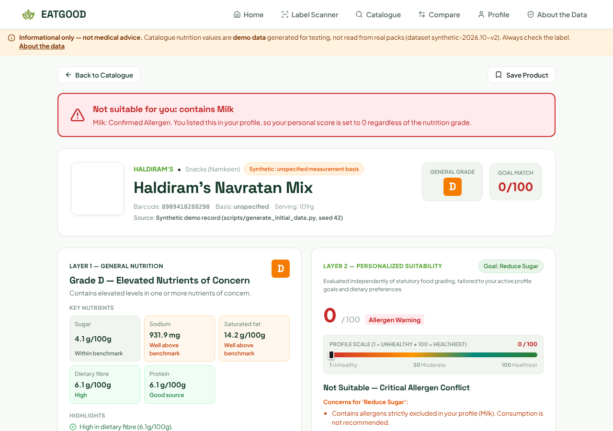

# EATGOOD

[](https://github.com/21Nandan/Nutritional-System/actions/workflows/ci.yml)
[](https://github.com/21Nandan/Nutritional-System/actions/workflows/codeql.yml)

EATGOOD helps people understand Indian packaged food labels. For a product it shows:

- an overall **nutrition grade** using category thresholds informed by WHO SEARO and FSSAI documents,
- a **personal fit score** for your goal (less sugar, less sodium, more fibre, more protein),
- **allergen checks** against the allergens you list, which always override the score,
- a check of **marketing claims** ("low fat", "high protein") against the numbers,
- **healthier alternatives** in the same category that don't contain your allergens.

You can browse and search packaged foods sold in India (or worldwide), look up a barcode (with the
camera or by typing it), or enter label values yourself. Product data comes from
[Open Food Facts](https://world.openfoodfacts.org), a community database.

**Live:** https://eatgood26.vercel.app



> **Informational only, not medical advice.** Product data is community-contributed and can be wrong
> or incomplete; always check the pack. The former built-in catalogue (852 products with generated
> values) is no longer used and is kept in `data/quarantine/` ([docs/DATA.md](docs/DATA.md)). EATGOOD
> is not affiliated with or endorsed by WHO or FSSAI, and its thresholds have not yet been verified
> against the source documents ([docs/THRESHOLDS.md](docs/THRESHOLDS.md)).

## Quick start

Requirements: Python 3.12+, Node 22+, [uv](https://docs.astral.sh/uv/), make.

```bash
make setup     # Python venv + npm install
make build     # build the frontend
make api       # http://127.0.0.1:8000 serves the API and the built frontend
```

For frontend development with hot reload, run `make dev` (API on :8000, Vite on :5173).

## Configuration

Every variable is optional. See [.env.example](.env.example) for the full list. Invalid values stop
the server at startup.

| Variable | Default | Purpose |
|---|---|---|
| `EATGOOD_ENV` | `development` | `development`, `test` or `production` |
| `EATGOOD_CORS_ORIGINS` | Vite dev origins | comma-separated origins; `*` is rejected |
| `EATGOOD_DB_PATH` | `data/eatgood_app.db` (`/tmp/...` on Vercel) | SQLite cache location |
| `EATGOOD_RATE_LIMIT` | `true` | per-IP limits for barcode, label text and contributions |
| `OFF_USER_AGENT`, `OFF_TIMEOUT_SECONDS`, `OFF_CACHE_TTL_HOURS` | see `.env.example` | Open Food Facts client |

No secrets are required.

## What leaves your device

| Data | Where it goes | Stored? |
|---|---|---|
| Profile: name, age group, activity | nowhere (browser only) | in your browser |
| Profile: goal, diet, allergens | EATGOOD API, with each request | no |
| Saved products and history | nowhere | in your browser |
| Values you type | EATGOOD API | no |
| Barcodes and search terms | EATGOOD API, which may ask Open Food Facts | Open Food Facts results are cached |
| Contributed products | EATGOOD API | yes, shown as unreviewed to others (per server instance on Vercel) |
| Page views | Vercel Web Analytics (anonymous, no cookies) | by Vercel |
| Product photos | loaded from Open Food Facts image servers | — |

## API overview

| Method and path | Purpose |
|---|---|
| `GET /api/health`, `GET /api/ready` | liveness; readiness (503 if SQLite is unreachable) |
| `GET /api/products` | catalogue from Open Food Facts: `query` (words, an unfinished last word, or a barcode), `category`, `india_only`, nutrient filters, `has_image`, `limit` (≤ 100), `offset`; each item carries its grade and Goal Match |
| `GET /api/products/search/openfoodfacts?q=&page=` | Open Food Facts world database only (search.openfoodfacts.org), 24 per page; a failed search is an HTTP error |
| `GET /api/products/categories` | categories |
| `GET /api/products/{id}` | full assessment (catalogue ID, `OFF_<barcode>`, `USER_SUB_<barcode>` or barcode) |
| `GET /api/products/barcode/{code}` | barcode lookup with assessment and alternatives |
| `GET /api/alternatives/{id}` | healthier alternatives without the user's allergens |
| `GET /api/compare?ids=a,b` | 2–4 products side by side |
| `POST /api/products/assess` | assess values you entered |
| `POST /api/products/contribute` | add a missing product (unreviewed) |
| `POST /api/assistant/ask` | rule-based answers about a product |
| `GET /api/standards` | thresholds and category specifications |

Personalised endpoints read the optional `X-Eatgood-Profile` header (URI-encoded JSON with `goal`,
`dietary_preference`, `allergens_to_avoid`). Errors use
`{"detail": {"error_code": "...", "message": "plain-language text"}}`. Interactive docs are at `/docs`.

## Testing

```bash
make check     # ruff, mypy, pytest with coverage, bandit, pip-audit, npm audit, frontend lint and build
make e2e       # Playwright with an offline test catalogue: catalogue, search, filters, compare, profile, scores (desktop + mobile)
make smoke URL=https://eatgood26.vercel.app   # post-deploy smoke test
```

CI runs all of this on every pull request (see the badge above). Test counts come from CI, not from
this file.

## Deployment

Vercel builds the frontend (`frontend/dist`) and serves the FastAPI app from `api/index.py` as a
Python function, with the `data/` files bundled (`vercel.json`). Security headers (CSP,
Permissions-Policy that allows the camera only for this site, HSTS) are set in `vercel.json`. After
each deployment, `.github/workflows/smoke.yml` checks health, readiness, product count, an image and
an Open Food Facts search.

### macOS: "CERTIFICATE_VERIFY_FAILED" on barcode lookups

The API verifies Open Food Facts' certificate against the `certifi` CA bundle (verification is never
disabled). If Python on macOS still fails, run `/Applications/Python\ 3.12/Install\ Certificates.command`
once, or behind a corporate proxy set `SSL_CERT_FILE` to your organisation's CA bundle.

## Limitations

- Product data comes from Open Food Facts and can be wrong or incomplete. Text searches rank the first
  100 results from the search service; ingredient text is not searchable. Products with severely
  incomplete or invalid key nutrition data are not listed (rules in docs/DATA.md).
- Thresholds are informed by, but not yet checked against, the cited documents. Chocolates and sweets are
  graded with EATGOOD's own method (not an official WHO or FSSAI grade; see docs/THRESHOLDS.md).
  Condiments get no grade.
- Label reading is English only and struggles with glare, curved packs and Hindi/bilingual labels.
- Profiles are per device. On Vercel, contributions and the Open Food Facts cache live per server
  instance and can disappear.
- Rate limits are per server instance, so they are best-effort on serverless.

More: [architecture decisions](docs/DECISIONS.md) · [data](docs/DATA.md) ·
[thresholds](docs/THRESHOLDS.md) · [audit report](AUDIT_REPORT.md)

## Licence and attribution

Code: [MIT](LICENSE). Product data from barcode lookups: © Open Food Facts contributors, available
under the [Open Database License (ODbL) 1.0](https://opendatacommons.org/licenses/odbl/1-0/); product
photos under CC BY-SA. Thresholds are informed by the WHO Nutrient Profile Model for the South-East
Asia Region (2017), WHO guidance on sugar-sweetened beverages, the FSSAI draft Indian Nutrition Rating
and the Codex nutrition labelling guidelines. These organisations have not reviewed or endorsed
EATGOOD. Barcode decoding uses [ZXing](https://github.com/zxing-js/library) (Apache 2.0).
